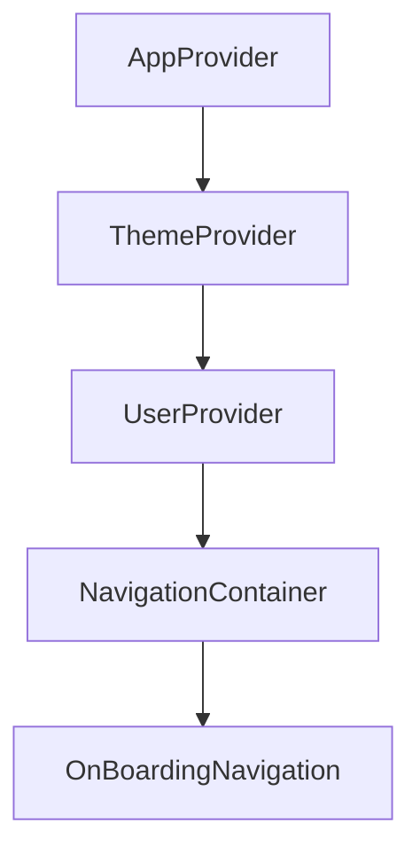

# LFI — Component Interactions

How the components that exist today interact. "Interacts with" means an actual call,
render, or context read in the current code.

## Context / provider graph

| Provider | Provides | Consumed by |
|----------|----------|-------------|
| `ThemeProvider` | `{ theme, setTheme, toggleTheme }` (`toggleTheme` is a **stub** returning `null`) | *(nothing yet reads `ThemeContext`)* |
| `UserProvider` | `{ userData, isFirstLaunch, isAuthenticated, setUserData, updateTheme, updateLaunch }` | `useUserContext` → `OnBoardingNavigation`, `AuthNavigation`, `OnboardingScreen`, `HomeScreen`, `ProfileScreen`, `EditProfileScreen`, `AppearanceScreen`, `LoginForm` |
| `AppProvider` | Composition + `NavigationContainer` + `StatusBar` | `App.tsx` |

> `useUserContext` (`src/hooks/UserHook.ts`) throws if used outside `UserProvider`.

## Interaction matrix

| Component | Reads / calls | Renders |
|-----------|---------------|---------|
| `App` | `Notifications.*` | `AppProvider` → `OnBoardingContainer` |
| `AppProvider` | — | `ThemeProvider`, `UserProvider`, `NavigationContainer`, `Loading` (Suspense fallback), `StatusBar` |
| `OnBoardingNavigation` | `useUserContext` (`isFirstLaunch`, `updateLaunch`), `storage.get` | `OnboardingScreen` **or** `AuthNavigation` |
| `AuthNavigation` | `useUserContext` (`isAuthenticated`) | `AuthScreen` **or** `AppNavigation` (+ `ForgotPasswordScreen`) |
| `AppNavigation` | — | bottom tabs → `HomeNavigation`, `PurchaseNavigation`, `ProfileNavigation`, `SettingsNavigation` |
| `OnboardingScreen` | `useUserContext.updateLaunch`, `storage.set` | paged onboarding UI |
| `AuthScreen` | local `tab` state | `LoginForm` **or** `SignupForm` |
| `LoginForm` | `useUserContext.setUserData`, `useNavigation` | form UI + social buttons (no handlers) |
| `SignupForm` | — | form UI (no handlers — **inert**) |
| `ForgotPasswordScreen` | local `email` state, `useNavigation` | reset-request form (logs only) |
| `HomeScreen` | `useUserContext` (`userData`), `useNavigation` | greeting, CTAs, list/purchase empty states |
| `PurchaseScreen` | local `query` state, `useNavigation` | search, filter, record CTA, empty list |
| `ProductItemScreen` | `useRoute` params | image placeholder, details card, action buttons |
| `PurchaseDetailScreen` | `useRoute` params | detail sections |
| `RecordPurchaseScreen` | — | form fields (no handlers) |
| `ProfileScreen` | `useUserContext` (`userData`), `useNavigation` | avatar, rows, sign-out (no-op) |
| `EditProfileScreen` | `useUserContext` (`userData`) | form fields |
| `SettingScreen` | `useNavigation`, `storage.clear` | preference / support / legal / developer rows |
| `Account`/`Help`/`About`/`Terms`/`Privacy`/`Licenses` | *(static; `Appearance` reads `userData`/`updateTheme`; `NotificationSettings` holds switch state)* | settings sub-screens |
| `SplashScreen` | *(retained, no longer routed)* | onboarding UI |
| `HeaderComponent` | `navigation` (goBack, navigate `"SettingsTab"`) | title + back/settings icons |
| `Button` | `cn` util | styled `TouchableOpacity` with variants/sizes |
| `Loading` | — | `ActivityIndicator` + text |
| `common/ScreenContainer`, `SectionCard`, `SettingRow`, `EmptyState` | `cn` util | structural layout primitives |

## Notable observations

- **`ThemeProvider` is still not consumed** — theming is inert (`AppearanceScreen` writes
  `userData.theme`, which nothing applies).
- **`SignupForm` is inert** — no `onPress`, uncontrolled inputs.
- **`HeaderComponent` hard-codes** navigation to `"SettingsTab"` regardless of route.
- Debug background colors (`bg-green-800`) were removed when the screens were scaffolded.
- `Button`, the `Header` icons, and the `common/*` primitives are the reusable UI seams;
  `common/*` and `Button` use the `cn` utility.

## Related documents

- `.workspace/LFI/LOGIC_FLOW_INDEX.md`
- `docs/architecture/COMPONENT_BOUNDARIES.md`
- `docs/REPOSITORY_STRUCTURE.md`
