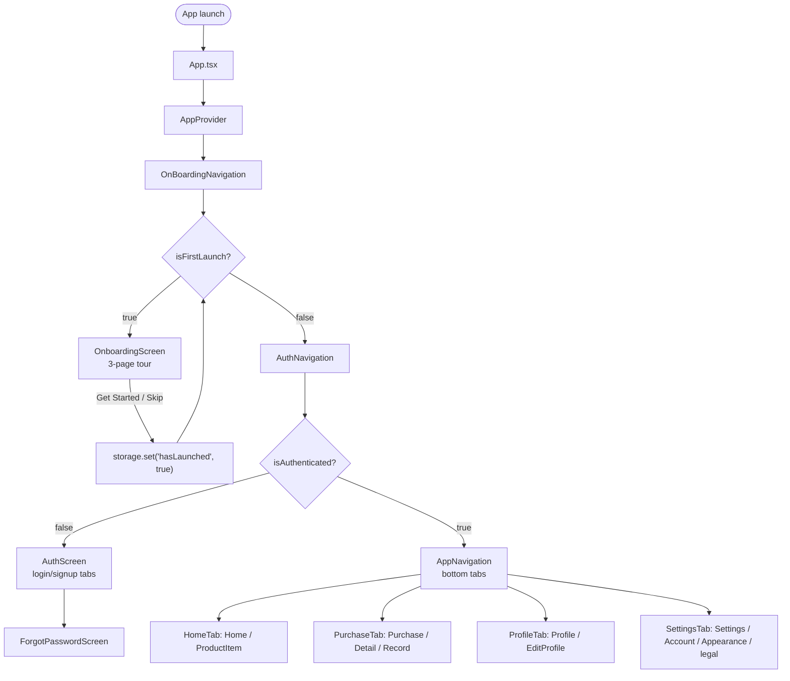
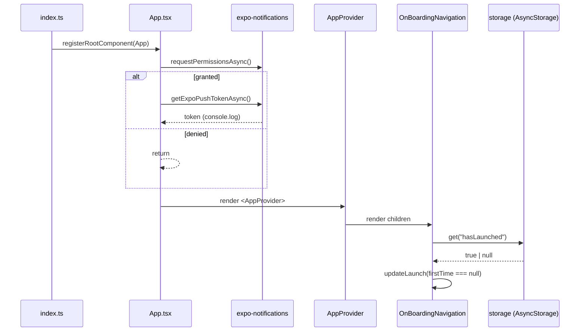
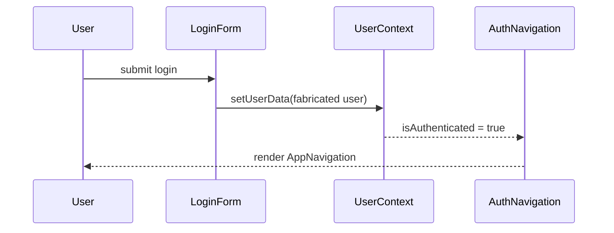
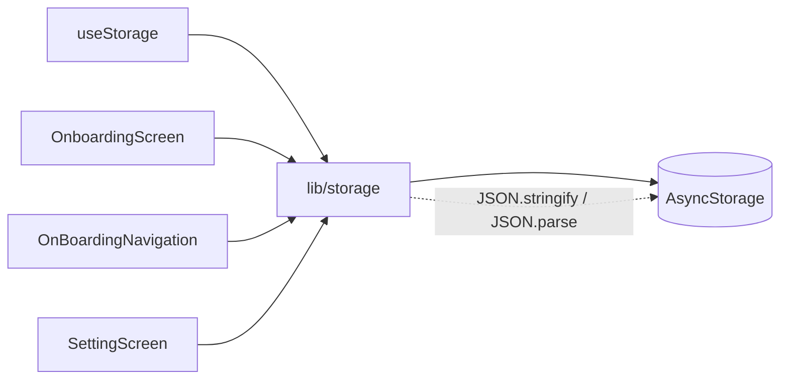

# LFI — Diagrams

Behavioural diagrams for the current implementation. All diagrams reflect **verified
code** unless marked `PROPOSED`.

## Navigation decision graph

## Bootstrap sequence

## Login (mock) sequence

## Storage wrapper contract

> All current access goes through the `storage` wrapper; the earlier direct-`AsyncStorage`
> write in `SplashScreen` was removed when onboarding moved to `OnboardingScreen`
> (see LF-004).

## Proposed domain data flow

See `docs/architecture/DATA_FLOW.md` (marked `PROPOSED`).

## Related documents

- `.workspace/LFI/LOGIC_FLOW_INDEX.md`
- `.workspace/LFI/COMPONENT_INTERACTIONS.md`
- `docs/architecture/DATA_FLOW.md`
