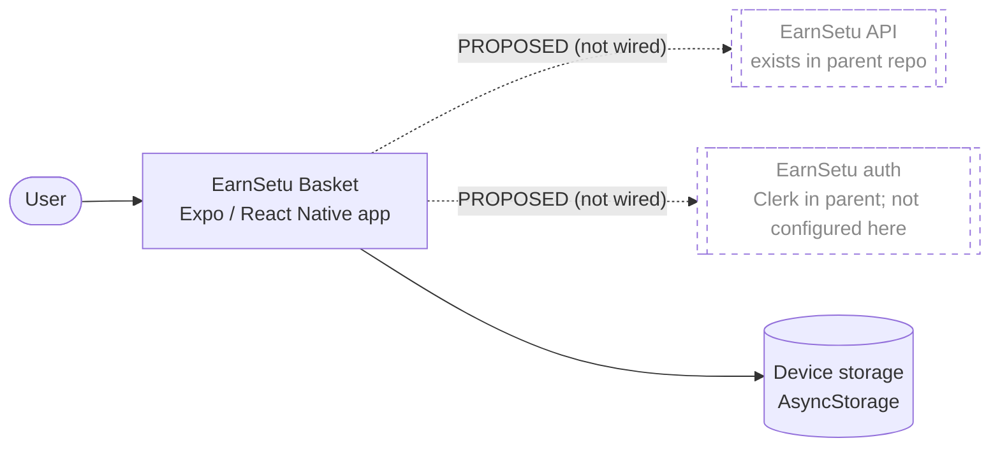
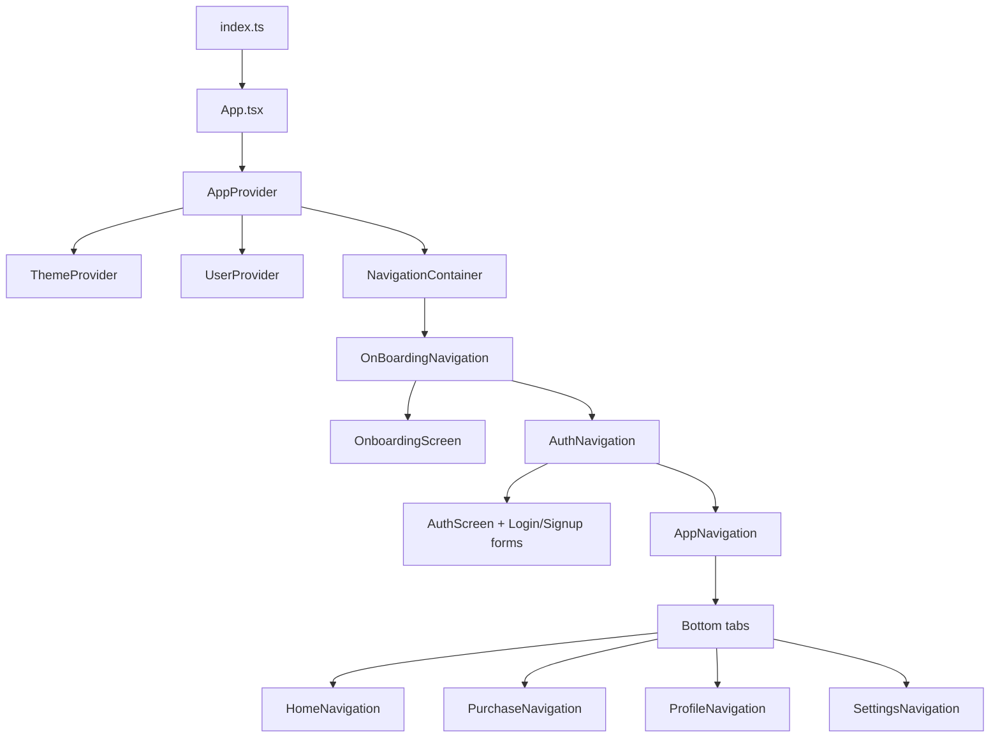

# Architecture — EarnSetu Basket

> **Scope:** This documents the **current, verified** architecture. Proposed/future
> architecture is explicitly labelled `PROPOSED`. The project is an early scaffold; most
> architectural concerns below are **not implemented**.

## 1. System context

EarnSetu Basket is intended to be a client application in the EarnSetu ecosystem. Today
it is a **self-contained Expo application with no external service integrations**.

- **Implemented:** the app runs on-device and can read/write key/value data through
  `AsyncStorage`.
- **Not implemented / unresolved:** backend, authentication, any server contract.

EarnSetu Basket is a planned **child/extension app** of the parent **EarnSetu** platform
(repo `coderooz/EarnSetu`, local `../../website/LocalCart`; Expo SDK 57 mobile app + Next.js
16 website). The parent has a real architecture, auth, and API routes, but **no
Basket-facing contract exists**, so no integration can be verified. See
[`architecture/INTEGRATION_BOUNDARIES.md`](architecture/INTEGRATION_BOUNDARIES.md).

## 2. Application layers (current)

The app is a single React Native process with a light layering enforced by convention:

| Layer | Location | Responsibility | State |
|-------|----------|----------------|-------|
| Entry | `index.ts`, `App.tsx` | Register root component; request notification permission | Implemented (skeleton) |
| Providers | `src/context/AppProvider.tsx`, `ThemeProvider`, `UserProvider` | Compose app-wide context + navigation container | Partial |
| Navigation | `src/navigation/*` | Root gate + auth gate + bottom tabs with per-tab stacks; typed params | Implemented (skeleton) |
| Screens | `src/screens/*` | 19 screen skeletons (onboarding, auth, home, purchase, product, profile, settings + legal) | Skeleton |
| Components | `src/components/*` | Shared UI (`Header`, `Loading`, `Button`, auth forms) | Minimal |
| Hooks | `src/hooks/*` | `useUserContext`, `useStorage` | Partial |
| Library/util | `src/lib/storage.ts`, `src/lib/utils.ts` | AsyncStorage wrapper; helpers | Partial |
| Domain | *(none)* | Shopping lists / items / purchases | **Not implemented** |

## 3. Feature boundaries

There are **no domain feature modules** yet. The only boundaries present are navigational
(onboarding vs. auth vs. the app shell, which itself splits into Home/Purchase/Profile/
Settings tabs). The intended domain boundary (Basket owns shopping lists
and purchase records; other domains own merchant/payments/accounting) is described in
[`PRODUCT_SCOPE.md`](PRODUCT_SCOPE.md) §5 but is **not enforced in code** because no
domain code exists.

## 4. Data ownership & persistence

| Concern | Current reality |
|---------|-----------------|
| Local persistence | A thin `AsyncStorage` wrapper (`src/lib/storage.ts`) with `get/set/update/remove/clear`. Used for flags like `hasLaunched`. |
| Database | **None.** `expo-sqlite` is installed and listed as an `app.json` plugin, but **zero code references** exist. |
| Remote persistence | **None.** No API client, no server. |
| Data ownership model | **Undefined.** No entities, no identity, no customer ownership. |

The only persisted key observed in code is an onboarding/launch flag. There is no
schema, no migration system, and no versioning.

## 5. Authentication boundary

**Not implemented.** `AuthScreen` renders login/signup UI whose submit handler fabricates
a local user object and toggles an `isAuthenticated` flag. There is no provider, no
token, no secure storage, and no API authentication. Clerk (`@clerk/expo`) is the
**intended** direction (unverified against any EarnSetu decision). See
[`AUTHENTICATION.md`](AUTHENTICATION.md).

## 6. API communication

**Not implemented.** There is no HTTP client, no base URL, no endpoint definitions. The
placeholder file `src/lib/fetchData.ts` is empty. See [`API_INTEGRATION.md`](API_INTEGRATION.md).

## 7. Synchronization responsibilities

**Not implemented.** There is no offline queue, no sync engine, no conflict handling. See
[`SYNCHRONIZATION.md`](SYNCHRONIZATION.md).

## 8. Error handling

Minimal. Notification permission failure returns silently; there is no global error
boundary, no logging, and no user-facing error system (the intended `AlertProvider` and
`ToastProvider` are empty files). See [`ERROR_HANDLING.md`](ERROR_HANDLING.md).

## 9. External dependencies (architectural significance)

- **Expo (SDK 57)** — managed workflow. Native projects (`ios/`, `android/`) are not
  committed; they are generated (CNG). Native config is expressed in `app.json` plugins.
- **NativeWind v4 / Tailwind v3** — styling.
- **React Navigation v7** — navigation. `@react-navigation/native`, `stack`, and
  `bottom-tabs` are in use (see
  [`decisions/ADR-0003`](decisions/ADR-0003_navigation-structure.md)); `drawer` and
  `native-stack` remain installed but **unused**.
- **expo-notifications** — permission/token request only.
- Unused-but-installed native/config packages (e.g. `expo-sqlite`, `expo-updates`,
  `expo-auth-session`, `expo-crypto`, `expo-linking`, `expo-symbols`) are inventoried in
  [`TECH_STACK.md`](TECH_STACK.md).

## 10. Known architectural gaps

1. **No domain model** — nothing represents a list, item, or purchase.
2. **No persistence layer** — AsyncStorage is a stopgap, not an offline-first store.
3. **No identity** — no authentication, no user ownership.
4. **No backend contract** — the parent EarnSetu backend exists, but no Basket-facing
   contract is defined.
5. **No error/observability layer.**
6. **No release configuration** — no EAS project, app identifiers, or CI.
7. **Unused dependencies** blur the intended architecture (e.g. SQLite configured but
   unused).
8. **Unused dependencies** blur the intended architecture (e.g. SQLite configured but
   unused; `drawer`/`native-stack` routers installed but unused).

## 11. Proposed architecture (NOT built)

Any target architecture (offline-first SQLite store, sync engine, Clerk auth, backend
client) is a **proposal** and must be captured as ADRs before implementation. See
[`ROADMAP.md`](ROADMAP.md) and [`decisions/README.md`](decisions/README.md).
