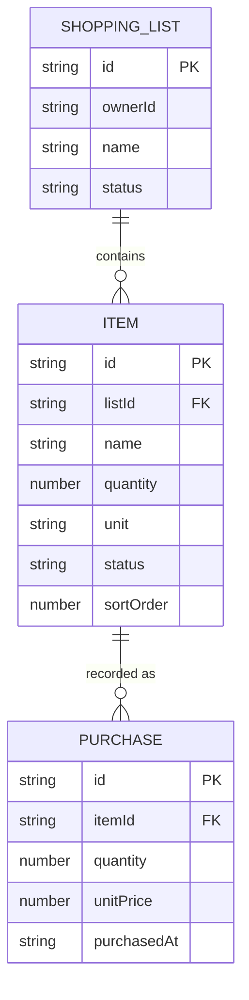

# Data Model — EarnSetu Basket

> **Status: NO IMPLEMENTED DATA MODEL.** There are no entities, tables, or schemas in the
> repository. This document records that fact and provides a **clearly-labelled design
> proposal** for discussion. The proposal is **not** the implemented schema.

## 1. Verified current state

- No database, no tables, no ORM, no schema files.
- No TypeScript domain types for lists, items, or purchases.
- The only persisted state is an onboarding/launch flag stored via `AsyncStorage`.
- `expo-sqlite` is installed and listed as an `app.json` plugin but is **unused**.

Evidence: absence of domain code under `src/`; `src/lib/storage.ts`;
`src/lib/connectDb.ts` (0 bytes).

## 2. Design proposal (NOT implemented)

> **This is a proposal.** It must be reviewed and accepted as an ADR before any
> implementation. Field names/types are illustrative, not binding.

### Proposed entities

**ShoppingList**
| Field | Type | Notes |
|-------|------|-------|
| `id` | string (UUID) | client-generated for offline creation |
| `name` | string | e.g. "Weekly groceries" |
| `createdAt` | ISO timestamp | |
| `updatedAt` | ISO timestamp | for change detection |
| `ownerId` | string | user identity (source unresolved — auth not implemented) |
| `status` | enum | `active` / `archived` |
| `deletedAt` | timestamp? | soft delete (sync-friendly) |

**Item**
| Field | Type | Notes |
|-------|------|-------|
| `id` | string (UUID) | |
| `listId` | string | FK → ShoppingList |
| `name` | string | |
| `quantity` | number | planned quantity |
| `unit` | string? | e.g. kg, pcs |
| `note` | string? | |
| `status` | enum | `to_buy` / `purchased` / `skipped` |
| `sortOrder` | number | reordering |
| `createdAt` / `updatedAt` | ISO timestamp | |
| `deletedAt` | timestamp? | soft delete |

**Purchase** (records what was actually bought)
| Field | Type | Notes |
|-------|------|-------|
| `id` | string (UUID) | |
| `itemId` | string | FK → Item |
| `quantity` | number | actual quantity (supports partial purchase) |
| `unitPrice` | number? | actual price |
| `totalPrice` | number? | derived or stored |
| `purchasedAt` | ISO timestamp | |
| `createdAt` / `updatedAt` | ISO timestamp | |
| `deletedAt` | timestamp? | soft delete |

### Proposed relationships

### Unresolved decisions (do not guess)

1. Identity/ownership key and whether data is per-user or per-household.
2. Whether lists are shared between users.
3. Whether `Purchase` records reference an `Item` or an independent `Product`.
4. Money representation (minor units vs decimal), currency handling.
5. Soft-delete vs hard-delete and retention policy.
6. Sync metadata (vector clocks / lamport timestamps / server version).

## 3. Constraints observed

There is no authoritative EarnSetu domain model to align with (none is published), so any
model here must be treated as **Basket-local** until a shared contract exists. See
[`architecture/INTEGRATION_BOUNDARIES.md`](architecture/INTEGRATION_BOUNDARIES.md).

## Related documents

- [`DATABASE_AND_MIGRATIONS.md`](DATABASE_AND_MIGRATIONS.md)
- [`OFFLINE_FIRST.md`](OFFLINE_FIRST.md)
- [`SYNCHRONIZATION.md`](SYNCHRONIZATION.md)
