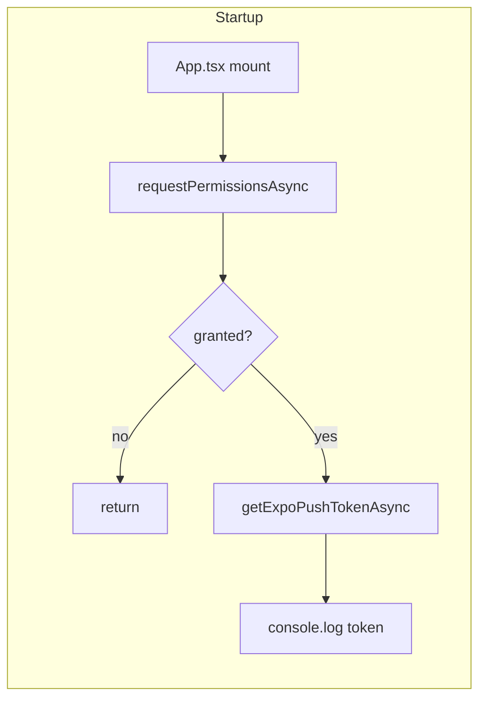
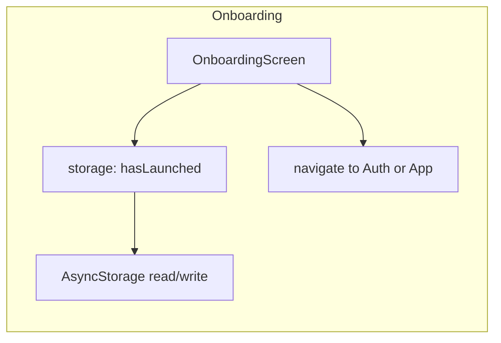
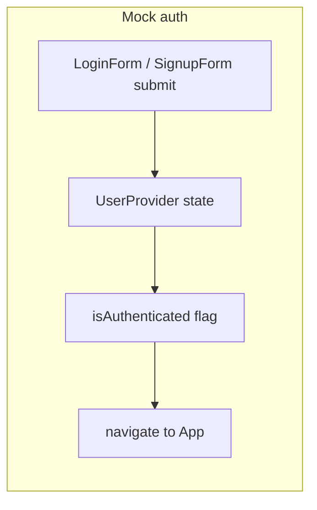
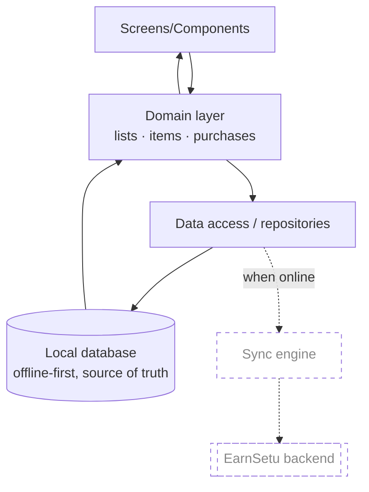

# Data Flow — EarnSetu Basket

## 1. Current data flow (verified)

The app has very little real data flow. The observed flows are:

### Summary

| Flow | Source → Sink | Persistence |
|------|---------------|-------------|
| Notification token | `App.tsx` → Expo → console | none |
| Onboarding flag | `OnboardingScreen` → `storage` wrapper → `AsyncStorage` | AsyncStorage |
| Mock user | auth forms → `UserProvider` context | in-memory only |
| Navigation | screens → navigators | in-memory |

There is **no domain data flow** (no lists/items/purchases) and **no network data flow**.

## 2. Intended data flow (proposed — NOT implemented)

Key intended properties (to be ratified as ADRs): local-first writes, local reads, pending
change tracking, and conflict-aware sync. See [`../OFFLINE_FIRST.md`](../OFFLINE_FIRST.md)
and [`../SYNCHRONIZATION.md`](../SYNCHRONIZATION.md).

## 3. Data ownership

Undefined today. Intended: each user owns their own lists/purchases; ownership enforced
server-side once auth and a backend exist.

## Related documents

- [`SYSTEM_CONTEXT.md`](SYSTEM_CONTEXT.md)
- [`../ARCHITECTURE.md`](../ARCHITECTURE.md)
- [`../DATA_MODEL.md`](../DATA_MODEL.md)
