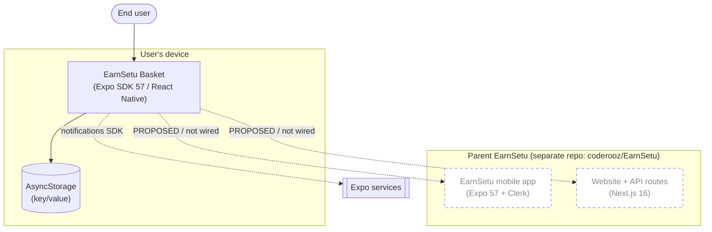

# System Context — EarnSetu Basket

EarnSetu Basket is a planned **child/extension app** of the parent **EarnSetu** platform
(repo `coderooz/EarnSetu`, local `../../website/LocalCart`). It owns a narrow slice —
shopping lists and purchase recording — for users who want only that capability, not the full
EarnSetu app.

## Actors

| Actor | Interaction | Status |
|-------|-------------|--------|
| End user (shopper) | Uses the app to plan and record shopping | UI scaffold only |
| Maintainer/developer | Develops and runs the app | Active |
| Parent EarnSetu platform | Basket is a planned child/extension app of it | **Exists** (Expo SDK 57 mobile + Next.js 16 website) |
| EarnSetu API (website routes) | Would serve Basket data/auth | **Exists in parent; not consumed by Basket** |
| EarnSetu auth (Clerk on mobile) | Would authenticate Basket users | **Exists in parent mobile app; not configured in Basket** |
| Expo services | Used for notifications (token) | Partial (token requested, unused) |

## Context diagram

## Verified vs proposed

| Element | Verified? |
|---------|-----------|
| On-device app + AsyncStorage | ✅ |
| Expo notifications SDK usage | ✅ (permission/token only) |
| Parent EarnSetu exists (mobile + website) | ✅ (verified in parent repo) |
| Basket ↔ EarnSetu integration | ❌ planned / not implemented |
| Any shopping-list domain | ❌ not implemented |

## External context

The parent **EarnSetu** project is a mature repository (Expo SDK 57 mobile app + Next.js 16
website with API routes and Clerk-based mobile auth). Basket is intended as a specialized
child/extension app, but **no Basket-facing contract exists** and the parent does not yet
reference Basket. See [`INTEGRATION_BOUNDARIES.md`](INTEGRATION_BOUNDARIES.md).
